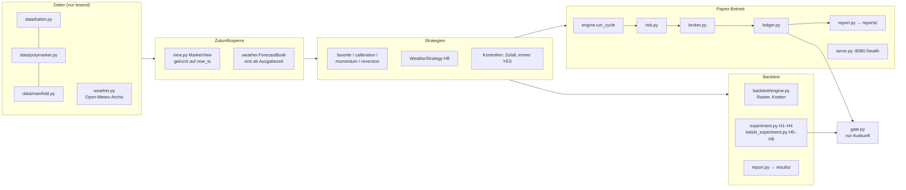

# Architektur und Optimierungsfahrplan

Stand 2026-11-03. Dieses Dokument ist die Landkarte für Menschen **und** für
KI-Sitzungen, die das System später weiter optimieren. Es beschreibt, was es
gibt, welche Regeln nie verletzt werden dürfen und in welcher Reihenfolge
sich Weiterarbeit lohnt. Jede Fahrplan-Aufgabe hat ein Abnahmekriterium.

## 1. Zwei Systeme in einem Repo

| | `backend/` (OASIS-Entscheider) | `paperbot/` (Papier-Handel) |
|---|---|---|
| Zweck | schlägt für eine Frage BET/WATCH/SKIP vor | handelt automatisch mit Papiergeld, misst ehrlich |
| Kern | 10 LLM-Agenten, `backend/core/orchestrator.py` | Regeln + Modelle, `paperbot/engine.py` |
| Entscheidet | der Mensch | niemand: es gibt kein Echtgeld |
| Tests | keine | `tests/` (≈ 220 Tests) |
| Oberfläche | FastAPI :8000, Streamlit :8501 | Streamlit-Seite „Papier-Portfolio“, `serve` :8080 |
| Verbindung | `paperbot/strategies/llm.py` (`llm_blend`) ruft die Pipeline, standardmäßig aus | |

Beide teilen sich **keinen** Geldpfad. Es gibt nirgends Order-, Wallet- oder
Signatur-Code (`tests/test_paper_only.py`).

## 2. paperbot im Überblick

### Module und ihre Aufgabe

| Schicht | Modul | Aufgabe |
|---|---|---|
| Modelle | `models.py` | `Market`, `PricePoint` (mit optionalem Geld/Brief), `Signal`, `Fill`, `Position` |
| Sperre | `view.py` | `MarketView`: Preise nur ≤ `now_ts`, Ergebnis unsichtbar |
| Daten | `data/*.py` | Quellen hinter `MarketDataClient` / `HistoricalSource` (`data/base.py`) |
| Daten | `data/http.py` | gedrosselter JSON-Client, Wiederholungen, `NotFoundError` |
| Wetter | `weather.py` | Stationen, Archiv-Vorhersagen, `TempModel`, `WeatherStrategy` |
| Strategien | `strategies/*.py` | geben höchstens ein `Signal` zurück, kennen weder Konto noch Ergebnis |
| Kosten | `fees.py` | Polymarket je Kategorie, Kalshi 0,07·P·(1−P) mit Cent-Aufrundung |
| Backtest | `backtest/engine.py` | Entscheidungsraster, erstes Signal, `CostModel` (angenommen oder echter Briefkurs) |
| Backtest | `backtest/experiment.py` | Protokoll: 60/40 chronologisch mit Sperrzone, Auswahl In-Sample, einmal Out-of-Sample, Kontrollen, Bonferroni |
| Backtest | `backtest/kalshi_experiment.py` | dasselbe für H5–H8, Bootstrap über Events |
| Statistik | `backtest/metrics.py`, `stats.py`, `montecarlo.py` | Bootstrap (auch geclustert), Brier, Ruin-Risiko |
| Live | `engine.py` | ein Zyklus: abrechnen → scannen → Strategien → Risiko → Papier-Kauf → speichern |
| Live | `risk.py`, `broker.py`, `ledger.py` | Größe/Deckel/Notbremse, Kauf gegen Orderbuch, atomares Kontobuch |
| Betrieb | `cli.py`, `serve.py` | Befehle; Dauerbetrieb mit Statusseite |
| Auskunft | `gate.py` | Was müsste erfüllt sein? Schaltet nichts frei |

## 3. Invarianten (nie verletzen)

| Regel | Wo durchgesetzt | Test |
|---|---|---|
| Nur Papiergeld, kein Echtgeld-Schalter | `paperbot/__init__.py`, `config.py` | `test_paper_only.py` |
| Strategie sieht nichts nach `now_ts` | `view.MarketView` (physisch gekürzt) | `test_core.py`, `test_weather.py` |
| Vorhersage erst ab Ausgabezeit | `weather.ForecastBook.get` → `LookaheadError` | `test_weather.py` |
| Preispunkt am **Ende** der Kerzenperiode | `data/kalshi.parse_candles` | `test_kalshi.py` |
| NO TRADE ist Standard, nichts erzwingt einen Kauf | `engine.py`, `risk.py` | `test_engine_cycle.py`, `test_kalshi_cycle.py` |
| Kosten nie über Budget/Bargeld | `broker.simulate_buy` (Kalshi: 1 ct Reserve) | `test_kalshi.py`, `test_core.py` |
| Hypothese vor Test, Varianten ehrlich zählen | `docs/HYPOTHESEN.md`, `results/trials.json` | Prozess (siehe 6.3: automatisieren) |
| Prüfstand findet eingebauten Vorteil, bestätigt bei fairen Märkten nichts | `backtest/synthetic.py` | `test_backtest_selftest.py`, `test_weather.py` |
| Konservative Schwellen (Kelly, Deckel, 40 % je Kategorie) | `config.BotConfig` | nur mit Rückfrage ändern |

## 4. Erweiterungspunkte

**Neue Datenquelle:** Klasse mit `source`, `list_open_markets`, `get_market`,
`price_history`, `book` (Live) und `resolved_markets` (Backtest). In
`cli._client`, `datasets.fetch_dataset`, `fees.fee_model_for` eintragen.
Abnahme: Parser-Tests mit Fixtures, kein Netz in Tests.

**Neue Strategie:** Dataclass mit `name`, `needs_history`, `live_only`,
`evaluate(view) -> Optional[Signal]`. Pflicht: Eintrag in
`docs/HYPOTHESEN.md` mit Datum **vor** dem Lauf, Kausalitätstest
(„Entscheidung gleich, wenn die Zukunft abgeschnitten wird“), Kontrollen
laufen automatisch mit.

**Neue Hypothesenrunde:** eigene Funktion `run_<runde>_experiment` nach dem
Muster von `kalshi_experiment.py`; `N_VARIANTS_<runde>` = Zahl der Varianten;
Register-Schlüssel je Runde.

## 5. Ergebnisse bisher

| Runde | Daten | Ergebnis |
|---|---|---|
| H1–H4 (2026-10-22) | Manifold, 2.000 Märkte | alle verworfen |
| H5–H8 (2026-10-27) | Kalshi, 1.143 + 924 Märkte | H5/H7/H8 verworfen, H6 zu wenige Trades. **H8 nur auf 2 Monaten** (Datenfehler, behoben) |

Lehre aus dem Datenfehler: Eine Stichprobe kann still schrumpfen. Deshalb
Fahrplan 6.1 b.

## 6. Fahrplan

Reihenfolge = Priorität. Jede Aufgabe ist so geschnitten, dass eine
KI-Sitzung sie allein umsetzen kann; Abnahme steht dabei.

### 6.1 Jetzt (P0)

a. **H8 sauber wiederholen.** Workflow `paperbot-backtest.yml` (Quelle
   kalshi) auf GitHub starten. Abnahme: Bericht nennt ≥ 10.000 Wettermärkte
   ab 2022-06; das Register zählt +8; das alte Urteil bleibt im Nachtrag
   von `HYPOTHESEN.md` stehen.

b. **Datenqualität als Pflichtkennzahl.** Jeder Datensatz-Abruf liefert
   ausgewählt / mit Preisen / verworfen (nach Grund) und Zeitraum; der
   Bericht zeigt das oben; Backtest bricht ab, wenn > 20 % verworfen sind.
   Abnahme: Test mit Attrappe, die die Hälfte verwirft → Abbruch mit klarer
   Meldung.

c. **Papier-Betrieb Kalshi auf einem VPS** (`docs/HOSTING.md`). Ziel: 100
   aufgelöste Papier-Trades je Strategie (bei Wetter: wenige Wochen). Erst
   dann sagt `gate` etwas.

### 6.2 Neue Hypothesen-Kandidaten (P1, noch NICHT registriert)

Nur nach Eintrag mit Datum in `HYPOTHESEN.md` testen. Jede erhöht die
Bonferroni-Zahl der Runde.

| Kandidat | Idee | Daten vorhanden? |
|---|---|---|
| Stadt-Kalibrierung | b und σ je Stadt (und Jahreszeit) statt global | ja (Open-Meteo-Archiv) |
| Modell-Ensemble | σ aus der Streuung mehrerer Wettermodelle (GFS, ECMWF, ICON über den `models`-Parameter) | ja, prüfen |
| Späte Entscheidung | Tag D morgens mit `previous_day1` statt Vortag | ja |
| Maker statt Taker | Limit am Geldkurs; braucht Füllwahrscheinlichkeit aus `/markets/trades` | teilweise |
| Bracket-Arbitrage | Summe der YES-Briefkurse aller Spannen eines Tages < 1 nach Gebühren | live messbar (wie `arbitrage.py`) |

### 6.3 Infrastruktur für KI-gestützte Optimierung (P2)

Ziel: Eine KI kann Läufe vergleichen und neue Varianten vorschlagen, ohne
die Regeln „Hypothese vor Test“ und „ehrlich zählen“ brechen zu können.

1. **Maschinenlesbares Experiment-Register** `results/experiments.jsonl`:
   je Lauf Hypothesen-IDs, Varianten, Daten-Fingerabdruck (Hash, Zeitraum,
   Ausfallquote), Git-Commit, Kennzahlen, Urteil. Ersetzt das reine Zählen
   in `trials.json` (das bleibt als Summe). Abnahme: Test, dass jeder
   `run_*experiment` genau eine Zeile schreibt.
2. **Vorab-Registrierung erzwingen:** Ein Lauf startet nur, wenn jede
   Hypothesen-ID mit Datum ≤ heute in `HYPOTHESEN.md` steht und die Zahl der
   Varianten dort zur Code-Konstante passt. Abnahme: Test mit fehlendem
   Eintrag → Abbruch.
3. **Varianten deklarativ** (JSON/YAML je Runde) statt im Code verstreut;
   Code liest die Datei, `N_VARIANTS` ergibt sich daraus. So kann eine KI
   Varianten vorschlagen, ohne Logik anzufassen.
4. **Walk-forward** als Option für künftige Runden (vorab festlegen): mehrere
   zeitliche Testfenster statt eines 60/40-Schnitts.
5. **Live-Telemetrie** für bessere Kostenmodelle: je Papier-Kauf
   Signalpreis, bestes Ask, Füllpreis, Spread, Tiefe → `fills.jsonl`.
   Daraus echter Schlupf statt angenommener 0–3 ct.
6. **Ein Befehl für den Gesamtstatus** (`python -m paperbot doctor`):
   Netz erreichbar? Modell vorhanden und wie alt? Letzter Zyklus? Ausfallquote
   der Daten? Für Menschen und für KI-Sitzungen als Einstieg.

### 6.4 OASIS-Backend (P3)

- Hat keine Tests (Regel: vor neuer Logik nach Testbarkeit fragen).
- Sinnvollster erster Schritt: Golden-Tests für `backend/core/scoring.py`
  (fee-adjusted Edge, Kelly-Gate) — reine Rechnung, ohne LLM.
- `llm_blend` ist nur live prüfbar; Prognose-Log `forecasts.jsonl` ab 100
  aufgelösten Märkten auswerten (Brier gegen Marktpreis).

## 7. Entscheidungen, die beim Menschen liegen

- Echtgeld: nie im Code. Auch ein bestandenes `gate` ist nur Auskunft;
  Rechtslage (Kalshi ist US-reguliert, Polymarket in DE eingeschränkt) und
  Steuern klären.
- Repo pushen und GitHub Actions aktivieren (startet Zyklus und Backtest).
- VPS mieten und `docker compose up -d`.
- Schwellen in `BotConfig` (aktuell bewusst konservativ, Kategoriegrenze 40 %
  bestätigt am 2026-10-29).
