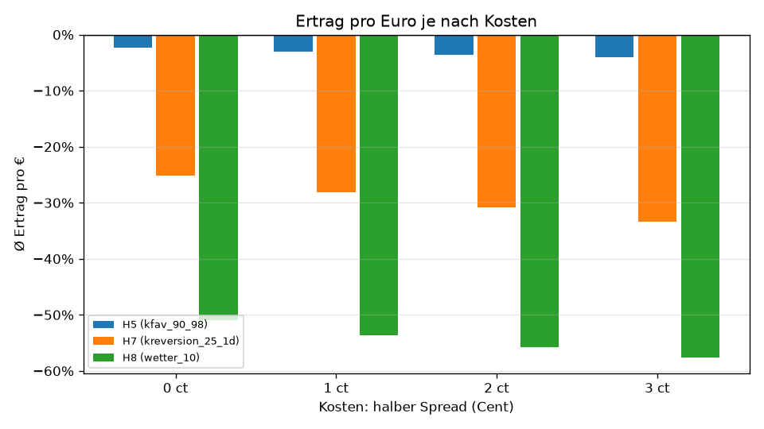
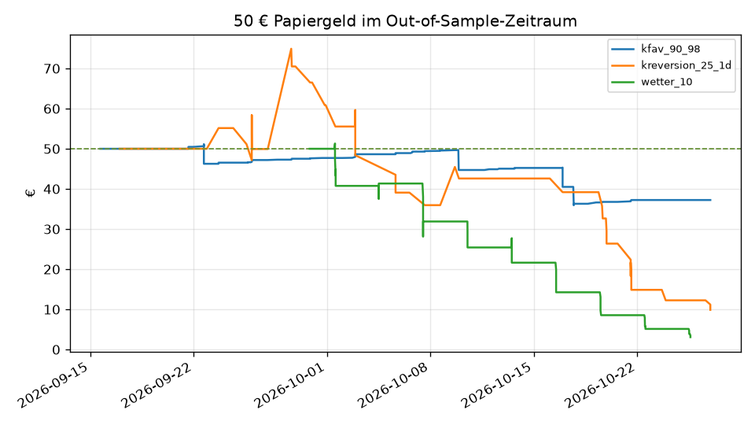
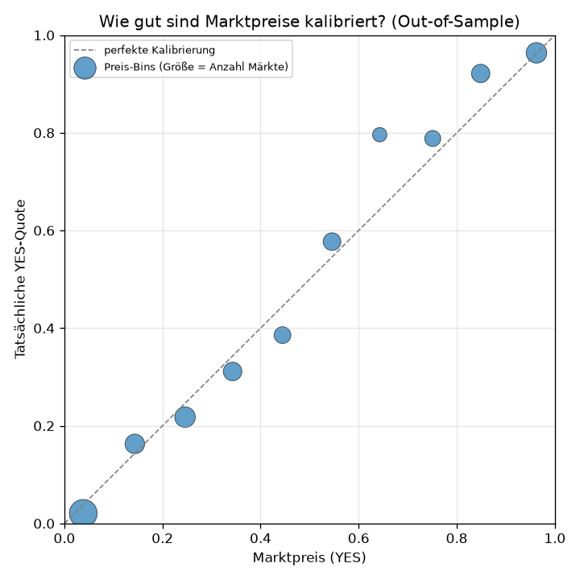

# Backtest: kalshi

Märkte insgesamt: 1143, Training (In-Sample): 346, Test (Out-of-Sample): 458. Kosten-Annahmen: halber Spread – je Seite, Gebühren-Modell: kalshi. Alle Schwellen wurden vor dem Test in docs/HYPOTHESEN.md festgelegt.

## Ergebnis auf ungesehenen Daten (Out-of-Sample)

| Hypothese | gewählte Variante | Trades | Ø Ertrag pro € | 95 %-Intervall | p-Wert | Trefferquote | Ø Preis | größter Verlust | Urteil |
|---|---|---|---|---|---|---|---|---|---|
| H5 | kfav_90_98 | 174 | -2.27 % | [-6.26 %, 1.16 %] | 0.8892 | 94.3 % | 94.5 % | -100.00 % | verworfen |
| H6 | – | – | – | – | – | – | – | – | zu wenige Trades In-Sample |
| H7 | kreversion_25_1d | 38 | -25.19 % | [-62.55 %, 11.27 %] | 0.9208 | 23.7 % | 28.2 % | -100.00 % | verworfen |
| H8 | wetter_10 | 263 | -50.99 % | [-69.55 %, -27.76 %] | 1.0000 | 22.1 % | 24.5 % | -100.00 % | verworfen |

Signifikanzschwelle nach Bonferroni: p ≤ 0.0063

## Kontrollen (gleiche Einstiegszeitpunkte)

| Kontrolle | Trades | Ø Ertrag pro € | 95 %-Intervall | Trefferquote |
|---|---|---|---|---|
| zufall@kfav_90_98 | 174 | -29.09 % | [-48.77 %, -5.07 %] | 50.6 % |
| immer_yes@kfav_90_98 | 174 | -19.87 % | [-51.56 %, 15.57 %] | 39.1 % |
| zufall@kreversion_25_1d | 38 | -4.85 % | [-33.15 %, 26.51 %] | 60.5 % |
| immer_yes@kreversion_25_1d | 38 | -0.46 % | [-38.91 %, 42.96 %] | 55.3 % |
| zufall@wetter_10 | 263 | -31.81 % | [-42.95 %, -18.36 %] | 48.7 % |
| immer_yes@wetter_10 | 263 | -43.36 % | [-57.08 %, -25.82 %] | 22.1 % |

## Kosten-Sensitivität

| Hypothese | 0 ct | 1 ct | 2 ct | 3 ct |
|---|---|---|---|---|
| H5 (kfav_90_98) | -2.27 % | -2.99 % | -3.57 % | -4.02 % |
| H6 | – | – | – | – |
| H7 (kreversion_25_1d) | -25.19 % | -28.18 % | -30.88 % | -33.34 % |
| H8 (wetter_10) | -50.99 % | -53.67 % | -55.79 % | -57.55 % |

Ø Ertrag pro € je Kostenstufe (halber Spread):

## 50 € Papiergeld nachgespielt

Startkapital je Strategie: 50.00 €.

| Strategie | Endwert (€) | max. Rückgang | gespielt | ausgelassen | Ruin-Risiko (−50 %) | Median / 5 % / 95 % (Monte-Carlo) |
|---|---|---|---|---|---|---|
| kfav_90_98 | 37.23 | 29.7 % | 45 | 129 | 12.4 % | 35.58 / 22.60 / 53.85 |
| kreversion_25_1d | 9.88 | 86.8 % | 32 | 6 | 82.0 % | 16.58 / 6.12 / 60.03 |
| wetter_10 | 3.08 | 94.0 % | 41 | 222 | 100.0 % | 0.00 / 0.00 / 0.00 |

> Achtung: kfav_90_98, kreversion_25_1d, wetter_10 hat im Einzelpfad weniger als 100 Trades gespielt (Limits bei 50 €). Ein einzelner Pfad mit so wenigen Trades ist Zufall. Maßgeblich sind der Ø Ertrag oben und die Monte-Carlo-Spalte über alle Trades.

## Kalibrierung der Marktpreise

| Marktpreis (YES) | Märkte | Ø Marktpreis | Tatsächliche YES-Quote |
|---|---|---|---|
| 0.0–0.1 | 486 | 3.8 % | 2.1 % |
| 0.1–0.2 | 221 | 14.4 % | 16.3 % |
| 0.2–0.3 | 248 | 24.6 % | 21.8 % |
| 0.3–0.4 | 196 | 34.3 % | 31.1 % |
| 0.4–0.5 | 153 | 44.5 % | 38.6 % |
| 0.5–0.6 | 175 | 54.6 % | 57.7 % |
| 0.6–0.7 | 103 | 64.3 % | 79.6 % |
| 0.7–0.8 | 137 | 75.1 % | 78.8 % |
| 0.8–0.9 | 191 | 84.9 % | 92.1 % |
| 0.9–1.0 | 248 | 96.2 % | 96.4 % |

Brier-Score der Marktpreise (Out-of-Sample): 0.1251

## Auswahl im In-Sample

### H5

| Variante | Trades | Ø Ertrag pro € |
|---|---|---|
| kfav_70_95 | 246 | -14.09 % |
| kfav_80_97 | 250 | -7.79 % |
| kfav_90_98 | 231 | -4.96 % |

Gewählt: kfav_90_98

### H6

| Variante | Trades | Ø Ertrag pro € |
|---|---|---|
| politik_60_85 | 4 | -1.23 % |
| politik_55_80 | 3 | -7.12 % |

Gewählt: –

### H7

| Variante | Trades | Ø Ertrag pro € |
|---|---|---|
| kreversion_25_1d | 45 | -30.49 % |

Gewählt: kreversion_25_1d

### H8

| Variante | Trades | Ø Ertrag pro € |
|---|---|---|
| wetter_05 | 210 | -32.61 % |
| wetter_10 | 178 | -10.50 % |

Gewählt: wetter_10

## Grenzen dieses Tests

- Die Märkte wurden nach Endvolumen bzw. Teilnehmerzahl ausgewählt. Das ist Wissen vom Marktende (leichte Auswahlverzerrung).
- Preise aus der Historie sind Mittel- oder Letztkurse. Der echte Kaufpreis liegt um den halben Spread höher; das ist als Kosten angesetzt, Markttiefe aber nicht.
- Manifold ist ein Spielgeld-Markt. Ergebnisse dort sind ein Hinweis, kein Beweis für Polymarket.
- Ein bestätigtes Ergebnis heißt nur: auf diesen Daten nicht durch Zufall erklärbar. Es garantiert keine Gewinne in der Zukunft.
- Die LLM-Strategie ist hier nicht enthalten, weil ein Sprachmodell vergangene Ergebnisse kennen kann.
