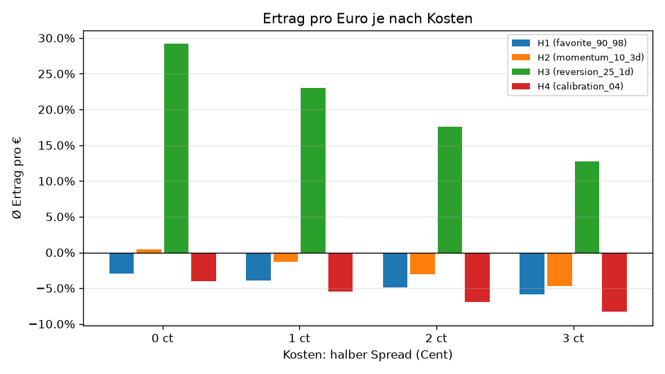
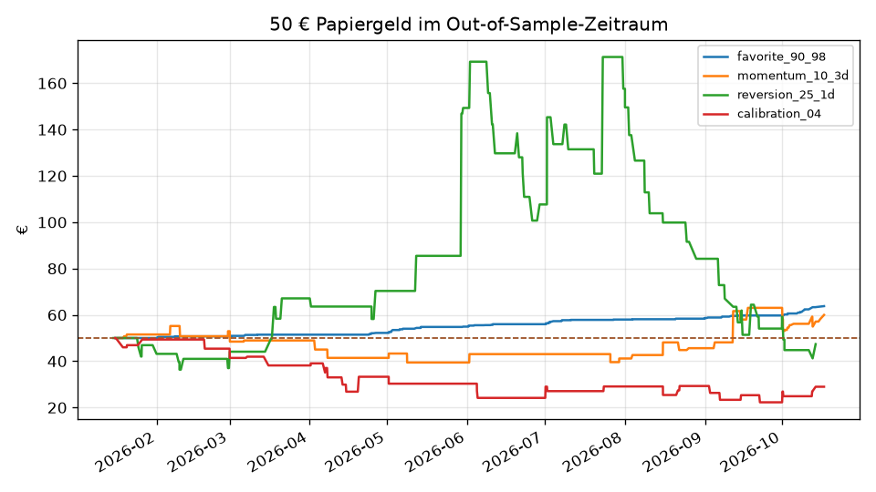
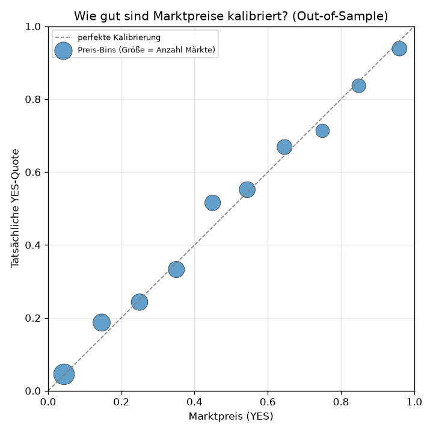

# Backtest: manifold

Märkte insgesamt: 2000, Training (In-Sample): 900, Test (Out-of-Sample): 800. Kosten-Annahmen: halber Spread 1 ct je Seite, Gebühren-Modell: none. Alle Schwellen wurden vor dem Test in docs/HYPOTHESEN.md festgelegt.

## Ergebnis auf ungesehenen Daten (Out-of-Sample)

| Hypothese | gewählte Variante | Trades | Ø Ertrag pro € | 95 %-Intervall | p-Wert | Trefferquote | Ø Preis | größter Verlust | Urteil |
|---|---|---|---|---|---|---|---|---|---|
| H1 | favorite_90_98 | 455 | -3.96 % | [-6.81 %, -1.22 %] | 0.9976 | 90.3 % | 93.1 % | -100.00 % | verworfen |
| H2 | momentum_10_3d | 517 | -1.35 % | [-8.59 %, 6.28 %] | 0.6363 | 64.8 % | 65.4 % | -100.00 % | verworfen |
| H3 | reversion_25_1d | 238 | 23.00 % | [-1.79 %, 50.90 %] | 0.0382 | 37.0 % | 28.3 % | -100.00 % | verworfen |
| H4 | calibration_04 | 404 | -5.49 % | [-13.04 %, 2.02 %] | 0.9276 | 67.1 % | 70.3 % | -100.00 % | verworfen |

Signifikanzschwelle nach Bonferroni: p ≤ 0.0056

## Kontrollen (gleiche Einstiegszeitpunkte)

| Kontrolle | Trades | Ø Ertrag pro € | 95 %-Intervall | Trefferquote |
|---|---|---|---|---|
| zufall@favorite_90_98 | 455 | 32.29 % | [2.16 %, 65.12 %] | 50.8 % |
| immer_yes@favorite_90_98 | 455 | 11.05 % | [-19.99 %, 43.51 %] | 36.3 % |
| zufall@momentum_10_3d | 517 | 5.02 % | [-6.62 %, 17.56 %] | 51.6 % |
| immer_yes@momentum_10_3d | 517 | -10.25 % | [-21.87 %, 1.65 %] | 44.3 % |
| zufall@reversion_25_1d | 238 | 10.00 % | [-8.55 %, 30.23 %] | 52.5 % |
| immer_yes@reversion_25_1d | 238 | -14.05 % | [-29.69 %, 3.65 %] | 46.2 % |
| zufall@calibration_04 | 404 | 3.88 % | [-9.14 %, 17.48 %] | 51.5 % |
| immer_yes@calibration_04 | 404 | -6.92 % | [-19.33 %, 6.29 %] | 48.8 % |

## Kosten-Sensitivität

| Hypothese | 0 ct | 1 ct | 2 ct | 3 ct |
|---|---|---|---|---|
| H1 (favorite_90_98) | -2.93 % | -3.96 % | -4.94 % | -5.83 % |
| H2 (momentum_10_3d) | 0.43 % | -1.35 % | -3.05 % | -4.68 % |
| H3 (reversion_25_1d) | 29.21 % | 23.00 % | 17.58 % | 12.77 % |
| H4 (calibration_04) | -4.00 % | -5.49 % | -6.93 % | -8.32 % |

Ø Ertrag pro € je Kostenstufe (halber Spread):

## 50 € Papiergeld nachgespielt

Startkapital je Strategie: 50.00 €.

| Strategie | Endwert (€) | max. Rückgang | gespielt | ausgelassen | Ruin-Risiko (−50 %) | Median / 5 % / 95 % (Monte-Carlo) |
|---|---|---|---|---|---|---|
| favorite_90_98 | 63.77 | 0.0 % | 46 | 409 | 96.9 % | 10.21 / 3.88 / 24.80 |
| momentum_10_3d | 59.97 | 28.6 % | 33 | 484 | 90.2 % | 8.20 / 0.64 / 109.26 |
| reversion_25_1d | 47.38 | 75.9 % | 59 | 179 | 49.8 % | 281.08 / 8.22 / 12265.86 |
| calibration_04 | 28.97 | 55.5 % | 31 | 373 | 97.4 % | 3.97 / 0.55 / 30.49 |

> Achtung: favorite_90_98, momentum_10_3d, reversion_25_1d, calibration_04 hat im Einzelpfad weniger als 100 Trades gespielt (Limits bei 50 €). Ein einzelner Pfad mit so wenigen Trades ist Zufall. Maßgeblich sind der Ø Ertrag oben und die Monte-Carlo-Spalte über alle Trades.

## Kalibrierung der Marktpreise

| Marktpreis (YES) | Märkte | Ø Marktpreis | Tatsächliche YES-Quote |
|---|---|---|---|
| 0.0–0.1 | 1083 | 4.4 % | 4.5 % |
| 0.1–0.2 | 732 | 14.6 % | 18.7 % |
| 0.2–0.3 | 658 | 25.0 % | 24.3 % |
| 0.3–0.4 | 637 | 35.0 % | 33.3 % |
| 0.4–0.5 | 584 | 44.9 % | 51.5 % |
| 0.5–0.6 | 609 | 54.4 % | 55.2 % |
| 0.6–0.7 | 531 | 64.6 % | 66.9 % |
| 0.7–0.8 | 415 | 75.0 % | 71.3 % |
| 0.8–0.9 | 441 | 84.9 % | 83.7 % |
| 0.9–1.0 | 505 | 96.0 % | 93.9 % |

Brier-Score der Marktpreise (Out-of-Sample): 0.1623

## Auswahl im In-Sample

### H1

| Variante | Trades | Ø Ertrag pro € |
|---|---|---|
| favorite_80_95 | 624 | -1.65 % |
| favorite_85_97 | 600 | -2.05 % |
| favorite_90_98 | 556 | -1.08 % |

Gewählt: favorite_90_98

### H2

| Variante | Trades | Ø Ertrag pro € |
|---|---|---|
| momentum_10_3d | 531 | -7.70 % |
| momentum_20_3d | 368 | -12.64 % |

Gewählt: momentum_10_3d

### H3

| Variante | Trades | Ø Ertrag pro € |
|---|---|---|
| reversion_15_1d | 425 | 23.27 % |
| reversion_25_1d | 248 | 39.70 % |

Gewählt: reversion_25_1d

### H4

| Variante | Trades | Ø Ertrag pro € |
|---|---|---|
| calibration_02 | 388 | -8.10 % |
| calibration_04 | 363 | -2.82 % |

Gewählt: calibration_04

## Grenzen dieses Tests

- Die Märkte wurden nach Endvolumen bzw. Teilnehmerzahl ausgewählt. Das ist Wissen vom Marktende (leichte Auswahlverzerrung).
- Preise aus der Historie sind Mittel- oder Letztkurse. Der echte Kaufpreis liegt um den halben Spread höher; das ist als Kosten angesetzt, Markttiefe aber nicht.
- Manifold ist ein Spielgeld-Markt. Ergebnisse dort sind ein Hinweis, kein Beweis für Polymarket.
- Ein bestätigtes Ergebnis heißt nur: auf diesen Daten nicht durch Zufall erklärbar. Es garantiert keine Gewinne in der Zukunft.
- Die LLM-Strategie ist hier nicht enthalten, weil ein Sprachmodell vergangene Ergebnisse kennen kann.
